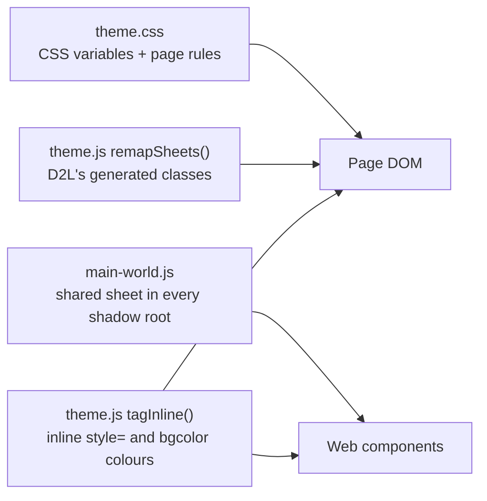

<p align="center">
  
</p>

<h1 align="center">Altera</h1>

<p align="center"><strong>CourseLink, refined.</strong></p>

<p align="center">
  A Chrome extension for the University of Guelph's CourseLink.<br />
  It's built to feel like part of CourseLink: no banners, badges or extra buttons on the page.
</p>

---

- [Built for Guelph](#built-for-guelph)
- [Install](#install)
- [Using Altera](#using-altera)
- [What it changes](#what-it-changes)
- [Design](#design): principles, palette, accents, components, popup, icon
- [How it works](#how-it-works): the theming engine, keep-alive, settings
- [Development](#development): layout, reloading, testing, tools
- [Limitations](#limitations)
- [Privacy](#privacy)
- [Contributing](#contributing) and [License](#license)

Contributors and coding agents should also read [AGENTS.md](AGENTS.md), which
holds the rules this document explains, and
[CONTRIBUTING.md](CONTRIBUTING.md) for how to get a change in.

Altera is an independent, unofficial project. It isn't affiliated with or
endorsed by the University of Guelph or D2L. CourseLink and Brightspace
belong to their owners, and Altera ships none of their logos or assets: it
recolours what CourseLink shows, in your browser.

## Built for Guelph

Altera was built for, and tested against, the University of Guelph's
CourseLink. Many schools run the same platform, D2L Brightspace, but Altera
hasn't been tried on any other school's site, and as shipped it only runs on
`courselink.uoguelph.ca`.

Most of the theme is built on Brightspace's own design tokens, so a lot of it
would likely carry over to another school. The parts tuned for Guelph would
not:

- the sign-in page (`/shared/login/`)
- University logos and lockups (`/shared/logos/`)
- University-authored pages shown in courses (`/shared/`)
- the homepage widgets and the custom links in the navigation
- the 3-hour session timeout, which is set per school

To try it elsewhere, replace `courselink.uoguelph.ca` with the other school's
Brightspace address in `manifest.json` (`host_permissions` and every
`content_scripts` entry), `src/background.js` (`COURSELINK`), and
`popup/popup.html` and `popup/popup.js` (the Open CourseLink link). Expect to
find pages that need their own fixes; [Development](#development) explains how
to track those down.

## Install

1. Get the code from [GitHub](https://github.com/P541M/altera): **Code →
   Download ZIP** and unzip it, or clone it with
   `git clone https://github.com/P541M/altera.git`.
2. Open `chrome://extensions` (or `edge://extensions`, `brave://extensions`).
3. Turn on **Developer mode** (top right).
4. Click **Load unpacked** and choose this folder (the one containing `manifest.json`).
5. Pin Altera from the puzzle-piece menu so its icon sits in the toolbar.

CourseLink tabs that are already open pick Altera up immediately; there's no
need to reload them. To update, pull (or download the ZIP again into the same
folder), then click the reload icon on Altera's card in `chrome://extensions`.

## Using Altera

Everything lives in the toolbar popup. Nothing is added to CourseLink itself.

| Control | What it does |
| --- | --- |
| **Session** | Whether you're signed in, and when the session was last refreshed. The refresh button refreshes now. |
| **Keep me signed in** | On by default. Turn it off to let CourseLink time out as usual. |
| **Appearance** | Light, Dark or System (follows your OS). |
| **Accent** | Link and button colour in the dark theme: Blue, Gryphon red, Gryphon gold, Violet or Mint. |
| **Darken course files** | Also darkens the HTML pages instructors upload. Turn it off if one looks wrong. |

**Alt+Shift+D** switches between light and dark from any tab. You can rebind it
at `chrome://extensions/shortcuts`.

## What it changes

- **A complete dark theme.** It covers the homepage, course tiles, Content,
  Dropbox and rubrics, Grades, Quizzes, Discussions, Groups, Calendar,
  Classlist, Announcements, Progress, FAQ, ePortfolio, Locker, Media Library,
  Self Registration, account settings, menus, tooltips, profile cards,
  dialogs, pop-up windows, the PDF viewer and the sign-in page, at desktop and
  phone widths.
- **No surprise sign-outs.** CourseLink ends a session after 3 idle hours.
  While a CourseLink tab is open, Altera makes the same request as CourseLink's
  own "Continue session" button every 5 minutes. It also stops Chrome's Memory
  Saver from discarding CourseLink tabs.
- **Logos in true colour.** The CourseLink and University of Guelph wordmarks,
  and University logos placed on course pages, get light lettering while the
  crest keeps its colours.

---

## Design

### Principles

The goal is that someone using CourseLink forgets an extension is involved.
Every decision follows from that:

1. **Native first.** The dark theme is CourseLink's own design system
   (Brightspace) with its colour values swapped. Shapes, spacing, type,
   shadows and motion are untouched. If CourseLink draws something, Altera
   recolours it; it doesn't redraw it.
2. **No gradients unless CourseLink has one you can see.** Several
   Brightspace surfaces fade from white to almost-white. That's invisible in
   light mode but shows as a band on dark, so those fades are flattened. The
   test for any gradient is to turn the theme off and look: if you can't see
   it in light mode, it doesn't exist in dark mode either.
3. **Tone, not lines.** Surfaces separate by elevation steps (each one a
   little lighter), the way CourseLink's greys do in light mode. Borders stay
   where CourseLink already draws them.
4. **No branding on the page.** Altera adds nothing to CourseLink: no
   badges, toasts, banners or "powered by". Its name and icon appear only in
   the toolbar popup.
5. **Accessible by construction.** Every text colour meets WCAG AA (4.5:1) on
   every surface it can land on, and control edges and focus rings meet 3:1.
   `tools/check-contrast.js` enforces this.
6. **Nothing flashes.** The theme is applied before the first paint, and
   stylesheets CourseLink adds later are recoloured before the browser draws
   them.

### Palette

A graphite that leans slightly blue, following Brightspace's own cool greys
(its light theme is built on blue-greys like `#f1f5fb` and `#e3e9f1`, so a
neutral grey would look foreign). It's defined once, as `--alt-*` custom
properties at the top of [`src/styles/theme.css`](src/styles/theme.css).

#### Surfaces (lowest to highest)

| Token | Hex | Used for | `--alt-text` on it |
| --- | --- | --- | --- |
| `--alt-bg` | `#0d1015` | Page background | 16.1:1 |
| `--alt-input` | `#10141a` | Text fields, sunk below the surface they sit on | 15.6:1 |
| `--alt-surface` | `#151920` | Nav bar, widgets, panels, tables | 14.9:1 |
| `--alt-surface-2` | `#1b2028` | Cards, table headers, subtle fills | 13.8:1 |
| `--alt-surface-float` | `#1e232b` | Menus, dropdowns, dialogs (anything floating) | 13.3:1 |
| `--alt-surface-3` | `#232932` | Hover | 12.3:1 |
| `--alt-surface-4` | `#2c333d` | Secondary buttons, pressed states, chips | 10.7:1 |

Inputs sit *below* the page (darker) rather than above it, which reads as
"type here" without needing a heavy border.

#### Lines

| Token | Hex | Used for |
| --- | --- | --- |
| `--alt-border` | `#262c35` | Dividers CourseLink already draws (table rows, panel edges) |
| `--alt-border-strong` | `#343b46` | Card and popover edges |
| `--alt-control-border` | `#6b7584` | Form controls: 3.1:1 or better on every surface, as WCAG 1.4.11 requires |

#### Text

| Token | Hex | Role | Lowest contrast on any surface |
| --- | --- | --- | --- |
| `--alt-text` | `#e8ecf1` | Primary text, headings | 12.3:1 |
| `--alt-text-2` | `#c3cad4` | Secondary text | 8.9:1 |
| `--alt-text-3` | `#9ba5b2` | Captions, placeholders, metadata | 5.9:1 |
| `--alt-icon` | `#b4bcc7` | Icons | 7.6:1 |
| `--alt-faint` | `#7d8693` | Decorative only (never text) | 4.0:1 |

Primary text is an off-white rather than pure white, which softens glare on
large text blocks without losing contrast.

#### Status

| Token | Hex | Lowest contrast |
| --- | --- | --- |
| `--alt-error` | `#ff8080` | 6.0:1 |
| `--alt-success` | `#5ed38c` | 7.8:1 |
| `--alt-warning` | `#f6ad62` | 7.7:1 |

Brightspace's alert and badge fills (light tints like `cinnabar-plus-2`)
become deep tints of the same hue, and the mid shades used as text on those
fills are lifted so they keep their contrast. The meaning of each colour
survives the switch.

#### Fixed colours

A few colours are deliberately not tokens, because they're CourseLink's own:

| Colour | Where | Why |
| --- | --- | --- |
| `#e87511` | Unread dots on the nav icons | CourseLink's orange. 5.9:1 on the nav bar. |
| `#b54a06` | Notification count badges | A deeper orange so white text passes (5.3:1). |
| `#39404b` | Tooltips | Brightspace fills tooltips with the text colour, which the palette makes near-white. |
| `#05070a` at 72% | Dialog backdrop | Dims the page instead of washing it out. |
| `#e8ecf1` / `#151920` | The icon | The text and surface tokens, so the mark matches the theme. |

#### Shadows

Brightspace's shadow geometry is kept exactly (`0 2px 12px` for floating
surfaces, `0 2px 4px` for attached ones). Only the colour deepens, to
`rgba(0,0,0,.5)` and `rgba(0,0,0,.35)`, because a light-mode shadow is
invisible on a dark page.

### Accents

The accent replaces Brightspace's "celestine" blue: links, primary buttons,
focus rings, selected tabs and highlights. Each one has a hover shade and an
"on-accent" colour for text on filled buttons.

| Accent | Accent | Hover | On-accent | Lowest link contrast | Button text |
| --- | --- | --- | --- | --- | --- |
| Blue (default) | `#66b2ff` | `#8fc6ff` | `#071423` | 6.5:1 | 8.3:1 |
| Gryphon red | `#ff7d8b` | `#ff9ea8` | `#2a050c` | 6.0:1 | 7.6:1 |
| Gryphon gold | `#f2c14e` | `#f7d47f` | `#231a02` | 8.7:1 | 10.3:1 |
| Violet | `#b7a3ff` | `#cbbcff` | `#160d36` | 6.8:1 | 8.5:1 |
| Mint | `#4fd6ac` | `#7ce2c2` | `#032419` | 8.0:1 | 9.1:1 |

"Lowest link contrast" covers every surface and the accent's own highlight
tint (`--alt-accent-tint`, the accent mixed 14% into the surface). Gryphon red
and gold come from the University's colours, lightened until they pass on
dark.

### How Brightspace's tokens map

Brightspace styles almost everything through two families of CSS variables.
The dark theme redefines them rather than overriding individual elements.

**The neutral scale** (`--d2l-color-*`) is mapped by *role*, not by
inverting lightness:

| Brightspace | Light value | Light-mode role | Dark value |
| --- | --- | --- | --- |
| regolith | `#f9fbff` | Faint fills | `--alt-surface-2` |
| sylvite | `#f1f5fb` | Hover fills | `--alt-surface-3` |
| gypsum | `#e3e9f1` | Pressed, secondary buttons | `--alt-surface-4` |
| mica | `#cdd5dc` | Borders | `--alt-border-strong` |
| corundum | `#b1b9be` | Strong borders | `#4a525e` |
| chromite | `#90989d` | Faint text, disabled | `--alt-faint` |
| galena | `#6e7477` | Muted text | `--alt-text-3` |
| tungsten | `#494c4e` | Secondary text | `--alt-text-2` |
| ferrite | `#202122` | Primary text | `--alt-text` |

**Semantic tokens** (`--d2l-theme-*`, used by newer components) map directly:
`background-color-base` becomes `--alt-surface`, `background-color-floating`
becomes `--alt-surface-float`, `text-color-static-standard` becomes
`--alt-text`, and so on. The full list is in `theme.css`.

### Component notes

Places where the token swap alone wasn't enough, and what was done:

| Component | Problem | Treatment |
| --- | --- | --- |
| Wordmark logos, and University lockups on course homepages | Black lettering disappears on dark; inverting would ruin the crest | Only the lettering pixels are recoloured (see [Logos](#logos)) |
| Loading spinner | Its arc is drawn by rotating wedges with hard-coded white fills | The wedge fills are matched to the disc and track by attribute |
| Unread dots | Fell back to a lightened orange that read as yellow | Pinned to CourseLink's `#e87511`, with a ring cut from the nav colour |
| Tooltips | Filled with the text colour, so white on near-white | A raised graphite fill |
| Course tile "..." button | The icon colour followed the on-accent token and vanished | White icon on a dark scrim, as in light mode |
| "Closed" badges on past courses | A white fill and a 2px white ring (the card's colour in light mode), with blue text at 2:1 | Fill and ring in the card's dark colour; the bold variant gets dark text |
| Past and future course images | CourseLink fades them and puts them behind the card's inner layers (`z-index: -1`), so any fill on those layers hides the photo | Only the card itself is filled, as in light mode |
| Semester tab arrows | `d2l-tabs` copies the colour behind it into an inline style when it loads, so after a theme switch the arrows kept the old theme's backing until a reload | Redone on every theme switch, using the component's own colour lookup |
| Legacy dialogs (group members, confirmations) | White frame, and a backdrop in the lightest grey that washed the page out | Floating surface and a near-black backdrop |
| Pop-up windows (Email) | Light title gradient, pale button bar, white recipient fields and chips with a white text-shadow | Flat surfaces, input-coloured fields, dark chips, no emboss |
| Tables | Header shading leaked onto data rows that are first in their own `tbody` | Shaded only for real column headers (`thead`, `scope="col"`), verified header by header against light mode |
| Content sidebar | The selected module's pointer is a white SVG triangle | Redrawn as a mask in the panel colour |
| Burger menu (phone widths) | Panel hard-coded white, and the scrim used the text colour | Surface panel, black scrim |
| Grade scheme chips | Inline pastel backgrounds that carry meaning | A deep tint of the same hue (see [Inline styles](#layer-4-inline-styles)) |
| Sign-in page | The yellow Sign In button's label turned light; Visitor Login lost its grey fill; the phone-width menu button is an unstyled browser button | Sign In keeps its dark label (`#111418`); Visitor Login and the menu button become secondary buttons with a 3:1 edge |
| PDF viewer | pdf.js only goes dark with the OS | Its own variables mapped to the palette; the pages themselves stay as authored |
| Instructor HTML files, and University pages shown in courses (`/shared/`) | Arbitrary colours and their own stylesheets (Bootstrap callouts, panels) | Inverted with a filter, with images and video flipped back |
| Side lists (Class Progress) | White rows, a light-blue selected row | Surface rows, the accent tint for the selected row |
| Rubrics (Dropbox feedback) | The table body inside the rubric component is hard-coded white | Surface, via the shadow sheet |
| Unread rows (Discussions) | A 4px dark-teal stripe drawn as a hard-stop gradient, 2.5:1 on dark | The same stripe as an inset edge in the accent |
| Profile cards (author names) | White card; its pointer is a white PNG sprite | Floating surface; the pointer redrawn as the same triangle in the card's colour |
| Legacy tables (Self Registration) | Cells coloured with the old `bgcolor` attribute | Tagged like inline styles (see [Inline styles](#layer-4-inline-styles)) |
| PDF viewer toolbar | CourseLink's View as Text and Download are unstyled bevelled buttons; its fullscreen button has no icon (a solid square in both themes) | Flat secondary buttons; pdf.js's own presentation-mode icon |

### The popup

The popup is the one place Altera is visible, so it's where the brand lives.
It follows the chosen theme: CourseLink's light values in light mode, and the
same palette as the page in dark mode.

- **One column, 320px**, in three sections: Session, Appearance and a footer.
  Section titles are small and muted, and controls are labelled in sentence case.
- **Theme previews** are miniature CourseLink pages (nav bar, a tile, two
  lines of text and a link) drawn with flat blocks. The dark preview's link
  takes the selected accent, so changing the accent shows in the preview.
  System is a hard split, light on the left and dark on the right.
- **Accent swatches** are 16px dots with a ring on the selected one. They're
  disabled (and say why on hover) in light mode, where accents don't apply.
- **Session status** is a 7px dot (green when active, amber when waiting,
  red on errors) next to a plain-language line ("Signed in · refreshed 2 min
  ago"). That line updates itself while the popup is open.
- Motion is limited to feedback: switches slide (140ms) and the refresh icon
  spins once. Both are off under `prefers-reduced-motion`.

### The icon

A single-storey **a**, a ring and a stem, in `--alt-text` on a squircle in
`--alt-surface`. One colour, with no gradient, shadow or second accent. The
stroke weight is shared by the ring and stem so the mark stays crisp at 16px,
and it's nudged slightly left of centre to balance the stem's weight. It works
on both Chrome's light and dark toolbars.

The PNGs are generated, never hand-edited:

```sh
python tools/make-icons.py            # writes icons/icon-{16,32,48,128,256}.png
python tools/make-icons.py preview.png  # also writes a light/dark toolbar preview
```

---

## How it works

### Files

```
manifest.json
src/
  background.js         Service worker: keep-alive alarm, shortcut, injection into open tabs
  shared/settings.js    Defaults and storage helpers (popup, worker and content scripts)
  content/
    main-world.js       Page world: dark sheet for every shadow root, logo recolouring,
                        hands keep-alive results to D2L's session manager
    theme.js            Isolated world: sets the theme attribute, recolours generated
                        stylesheets and inline styles
    session.js          Top frame: calls CourseLink's session-extend endpoint
  styles/theme.css      The palette and every page-level rule
popup/                  Toolbar popup (HTML, CSS, JS)
icons/                  Generated by tools/make-icons.py
tools/
  check-contrast.js     WCAG check of every colour pairing
  check-tokens.js       Every var(--alt-*) the code uses is defined
  make-icons.py         Icon generator
```

There's no build step, no dependencies and no framework. The folder you load
is the source.

### Load order

| Script | World | When | Frames |
| --- | --- | --- | --- |
| `main-world.js` | Page (`MAIN`) | `document_start` | All, including `about:blank` |
| `theme.css` + `settings.js` + `theme.js` | Isolated | `document_start` | All, including `about:blank` |
| `session.js` | Isolated | `document_idle` | Top frame only |

Running at `document_start` in every frame matters: CourseLink nests pages in
iframes (homepage widgets, dialogs, the content viewer, the PDF viewer), and
each one has to be dark before it paints.

### The theme attribute

Everything hangs off one attribute on `<html>`, set by `theme.js`:

| `data-altera-theme` | Set on | Effect |
| --- | --- | --- |
| `dark` | CourseLink pages | The full palette swap |
| `pdf` | The pdf.js viewer frame | pdf.js variables mapped to the palette |
| `content` | Instructor files under `/content/` and University pages under `/shared/` (except the sign-in page) | Filter inversion (if **Darken course files** is on) |
| *(absent)* | Light mode, and while printing | Nothing applies; CourseLink is untouched |

Every rule in `theme.css` and the shadow sheet is scoped under this
attribute, so switching themes is one attribute change. It takes effect in a
single frame with no reload, and light mode is guaranteed to be CourseLink's
own. `data-altera-accent` sits alongside it and swaps the accent variables.

The attribute is also removed for the length of a print (`beforeprint` /
`afterprint`), so printouts use CourseLink's own light print styles. Browsers
drop page backgrounds when printing, so the dark theme would otherwise print
light text on white paper.

### The four layers



#### Layer 1: CSS variables and page rules

`theme.css` redefines Brightspace's variables under `html[data-altera-theme="dark"]`.
Most of CourseLink follows those variables, so this layer alone handles most
of the UI. The rest of the file covers legacy markup that hard-codes
colours in Brightspace's CDN stylesheets, which are cross-origin and can't be
read or rewritten at runtime. Rules there use `!important` because CourseLink's
own rules are often inline or highly specific; selectors are kept as narrow as
the problem allows.

#### Layer 2: Shadow DOM

Brightspace's newer UI is built from Lit web components. Page CSS can't reach
inside a shadow root, though CSS variables can. Anything a component
hard-codes needs a stylesheet *inside* its shadow root.

`main-world.js` runs in the page's own JavaScript world and:

1. Builds one constructed `CSSStyleSheet` (`SHADOW_CSS`).
2. Patches `Element.prototype.attachShadow` so every new shadow root adopts it.
3. Patches the `ShadowRoot.prototype.adoptedStyleSheets` setter so the sheet
   stays *last* even when Lit replaces a root's sheet list after attaching
   it. Last means it wins ties.
4. Enables the sheet only while `data-altera-theme="dark"` (a
   `MutationObserver` on `<html>`).

It's one shared sheet object, not a copy per root, so it costs almost nothing
on pages with thousands of components.

#### Layer 3: Generated stylesheets

D2L emits per-page classes with literal colours (for example
`.d2l_1_23_456 { color: rgb(32, 33, 34) }`) in same-origin `<style>`
elements, and some components inject sheets at runtime (for example
`.d2l-table > tbody { background: #fff }`). `theme.js` reads every readable
sheet and writes dark equivalents into `<style id="altera-remap">`, scoped
under the theme attribute:

| Found | Rule | Becomes |
| --- | --- | --- |
| Text colour | A saturated blue (hue 195–240°, a link colour like `#006fbf` or `#295376`) | `--alt-accent` |
| | Luminance < 0.2 | `--alt-text` |
| | < 0.4 | `--d2l-color-tungsten` (text-2) |
| | < 0.5 | `--alt-text-3` |
| Background | Luminance > 0.85 | `--alt-surface` |
| Border (each side) | Luminance > 0.7 | `--alt-border` |
| Gradient | Any stop with luminance > 0.85 | `background-image: none` |

Colours that already use `var(...)` are left alone, since layer 1 handles them.
`@media`, `@supports`, `@container` and `@layer` conditions are kept around
the rewritten rules (and a `<link media="print">` sheet stays print-only), so
a print rule like `* { color: #000 !important }` never becomes a screen rule.
Groups whose condition can't be carried over (`@scope`, `@starting-style`)
are left alone.

A `MutationObserver` remaps as soon as a `<style>` is added. Its callback
runs before the browser renders, so no frame is ever painted with the light
colours. Each sheet is rewritten once and cached (new content means a new
sheet object), so pages that keep adding styles as they load don't pay for
the ones already done. Same-origin `<link>` sheets are remapped once they
load.

#### Layer 4: Inline styles

Server-rendered markup often carries `style="background-color: …"`, and older
pages colour table cells with the legacy `bgcolor` attribute. `theme.js` tags
those elements and the stylesheets style the tags. Any CSS colour is
understood, named ones (`black`, `whitesmoke`) included; values that depend on
context (`currentcolor`, `var()`, `inherit`) are left alone.

The same tagging covers the shadow root of `d2l-html-block`, the component
that renders instructor-written HTML (announcements, discussion posts), where
pasted text often carries `color: black` or a highlight. `main-world.js`
watches those roots and dispatches a composed `altera:authored-html` event
when one renders; `theme.js` catches it on the document and tags the root
(it's open, so the isolated world can reach it). The tag rules live in both
`theme.css` and `SHADOW_CSS`. The tagger stays in one world because Chrome
injects a file only once per frame, even when two content-script entries in
different worlds list it.

| Inline colour | Tag | Becomes |
| --- | --- | --- |
| White (every channel ≥ 245) | `data-altera-bg="white"` | `--alt-surface` |
| Light (luminance > 0.7) and neutral (saturation < 3%) | `data-altera-bg="neutral"` | `--alt-surface-2` |
| Light and tinted (grade scheme colours, highlights) | `data-altera-bg="tint"` | `hsl(<same hue> 42% 21%)` with light text |
| Dark text (luminance < 0.3) | `data-altera-fg="dark"` | `--alt-text` |

The tint rule is why a green "A" grade chip stays green: the hue carries
meaning, so it's kept and only the lightness changes. Attribute selectors in
`theme.css` also catch the common white spellings
(`background-color: #fff`, `white`, ...) before the tagger has run.

### Logos

The CourseLink and University of Guelph wordmarks, and the University's
official lockups (`/shared/logos/`) that instructors place on course
homepages, are PNGs with black lettering beside a coloured graphic. Inverting them would turn the crest into
its negative, so `main-world.js` redraws them instead:

1. Fetch the image and draw it to an `OffscreenCanvas`.
2. Skip logos with an opaque background (they already read on dark).
3. Find the graphic: columns containing saturated pixels (saturation > 0.35),
   with gaps of 4px or less bridged so the crest counts as one block.
4. Outside the graphic, recolour dark neutral pixels (the lettering) to
   `--alt-text`, keeping each pixel's alpha so anti-aliased edges stay smooth.
   Dark brand colours anywhere in the image (Guelph-Humber's navy lettering)
   keep their hue and are lifted to 75% lightness, so navy becomes a steel
   blue that reads on dark. Bright crest colours are never touched. The cache
   key is versioned (`altera.logos.v2`) so logos recoloured by an older
   version are redone.
5. Swap the result in with a rule in the logo sheet:
   `img[src="…"] { content: url(data:…) }`. It switches off with the theme,
   survives component re-renders, and is cached in CourseLink's
   `localStorage` so later pages show it on first paint. Only the top frame
   loads the cache. That storage is CourseLink's own (D2L keeps its session
   state there too), so the cache keeps the newest logos within 300,000
   characters, and a logo too large for that is recoloured on each page
   instead.

### No flash, no flicker

- **Before first paint.** `chrome.storage` is asynchronous, so waiting for it
  would show a white page first. Settings are mirrored into CourseLink's own
  `localStorage` (`altera.settings`), which `theme.js` reads synchronously at
  `document_start`.
- **Runtime stylesheets.** These are remapped inside the `MutationObserver`
  callback, which runs before the next paint, and the known ones (like the table
  component's white `tbody`) are also covered statically in `theme.css`. An
  earlier version debounced this by 120ms, and the Grades table flashed grey
  while CourseLink faded the page in.
- **Theme switches** are a single attribute change: one style recalculation,
  one frame.
- The fade-in on each page load is CourseLink's own animation, and it happens
  in light mode too.

### Already-open tabs

Content scripts normally load only with a page. On install and update (not on
browser updates), `background.js` injects the same CSS and scripts into every
open CourseLink tab (the `scripting` permission), so they switch over without
a reload. It first asks each tab whether it already runs the current version.
Only current scripts can answer, so a tab that loaded after the update isn't
injected twice, which would double its keep-alive pings.

### Keep-alive

```mermaid
sequenceDiagram
  participant W as background.js
  participant T as session.js (CourseLink tab)
  participant C as CourseLink
  participant M as main-world.js
  W->>W: alarm, every 5 min
  W->>T: altera:keepalive
  T->>C: POST /d2l/lp/auth/session/extend (X-Csrf-Token)
  C-->>T: while(1);{"Data":{"session":{...}}}
  T->>M: altera:session event
  M->>M: D2L.PT.Auth.SessionTimeout.RpcReceivePayloadProvider(session)
  T-->>W: { status: "active" }
  W->>W: chrome.storage.local.session (shown in the popup)
```

- The request is the one CourseLink's own "Continue session" button makes,
  with the anti-forgery token CourseLink keeps in `localStorage`
  (`XSRF.Token`). It has to run in the page so it carries the page's cookies.
- The response goes to D2L's own session manager, which resets the "your
  session is about to expire" timer in every open CourseLink tab.
- An expired session is reported to the popup but not to D2L, so Altera never
  pops CourseLink's "session expired" dialog over a false alarm. That
  includes the case where the University sign-in itself has lapsed and
  CourseLink answers with a redirect to it (the request uses
  `redirect: "manual"` to tell the two apart from a network error).
- While keep-alive is on, CourseLink tabs are marked
  `autoDiscardable: false`, so Memory Saver doesn't put them to sleep and stop
  the pings.
- If a tab doesn't answer (it was opened before an update), the popup says
  "Reload your CourseLink tab to reconnect".

### Settings

| Key | Default | Stored in |
| --- | --- | --- |
| `theme` | `"dark"` | `chrome.storage.sync`, mirrored to CourseLink's `localStorage` |
| `accent` | `"blue"` | Same |
| `darkContent` | `true` | Same |
| `keepAlive` | `true` | `chrome.storage.sync` |
| last ping result | n/a | `chrome.storage.local` |
| `systemDark` | n/a | `chrome.storage.local`: the OS theme, recorded by CourseLink tabs and the popup, because the worker (which handles the shortcut) has no `matchMedia` |

Defaults live in `src/shared/settings.js`, which the popup, the worker and the
content scripts all load.

---

## Development

### Making a change

1. Edit the files. There's nothing to build.
2. In `chrome://extensions`, click the reload icon on Altera's card.
3. Reload a CourseLink tab, or just navigate. (Already-open tabs get the new CSS
   and `theme.js` on reload of the extension, but `main-world.js` only
   refreshes on the next page load.)

### Fixing something that's still light

Find the element with DevTools, then pick the layer:

| The colour comes from... | Fix it in |
| --- | --- |
| A Brightspace variable (`--d2l-color-*`, `--d2l-theme-*`) | The palette block at the top of `theme.css` |
| A rule in Brightspace's CDN CSS, on a normal element | A page rule in the matching section of `theme.css` |
| Inside a shadow root (the element is under `#shadow-root`) | `SHADOW_CSS` in `main-world.js` |
| A same-origin `<style>` with literal colours | Usually handled already by layer 3; if not, check the thresholds |
| An inline `style=` or legacy `bgcolor` attribute | Layer 4 tags it; add a rule for the tag if needed |

Then check that it doesn't add a gradient or border CourseLink doesn't have
(toggle the theme off and compare), that light mode is unchanged, and run the
contrast check.

### Tools

```sh
node tools/check-contrast.js            # every pairing, from theme.css and popup.css
node tools/check-contrast.js --verbose  # print each ratio
node tools/check-tokens.js              # every var(--alt-*) used is defined
python tools/make-icons.py              # regenerate the icons (needs Pillow)
```

### How it was tested

Altera is checked in a real Chromium with the unpacked extension loaded
(Playwright, signed in to a student account). The crawl scripts aren't part
of the repository, since they need a signed-in account; the verification
checklist in [AGENTS.md](AGENTS.md) is the same check done by hand, and the
pull request template walks through it:

- **Every page.** The crawl visited every tool linked from the navigation across
  five courses: home, course homes, Content and its topics, Dropbox folders,
  feedback and history, Grades, Quizzes and submission history, Discussions
  (lists, topics, threads), Groups, Calendar and events, Classlist,
  Announcements, FAQ, Progress, ePortfolio, Locker, Media Library, Self
  Registration, course search, profile, notifications and account settings.
- **Every control.** On each page it opened every menu, dropdown, tab and
  expander, hovered every distinct kind of control, and caught pop-up windows.
- **Measured contrast** for every visible text element on every page and
  same-origin frame, against its real background (walking up through
  transparent ancestors), at 4.5:1, or 3:1 for large text.
- **Automated audit** of each state, through every shadow root: any background
  lighter than mid-grey, any text darker than mid-grey, and any gradient. Each
  gradient was compared with the same page with the theme off.
- **Phone widths** (390px), including the burger menu and the nav trays.
- **Flicker**: page loads and theme switches were recorded frame by frame
  (Chrome DevTools screencast) and checked for any light frame.
- Nothing is ever submitted, posted, sent or started during testing.

---

## Limitations

- **Guelph only.** Altera is tuned for the University of Guelph's CourseLink
  and untested on other schools' Brightspace sites (see
  [Built for Guelph](#built-for-guelph)).
- **Chrome's own dialogs** ("Leave site? Changes you made may not be saved")
  are drawn by the browser, not the page. They follow your OS theme, and no
  extension can restyle them.
- **External tools and embeds** (publisher tools, H5P activities, video
  players and other sites shown inside a frame) are other websites and keep
  their own look.
- **Instructor files** are darkened by inversion, which is right for text but
  can shift colours in diagrams drawn with CSS. Images and video are flipped
  back. Turn off **Darken course files** for a page that looks wrong.
- **Single sign-on** has its own limit. Keep-alive keeps the CourseLink session
  going, but if the University's sign-in itself expires you'll be asked to
  sign in again.
- **Keep-alive needs an open tab.** It works while at least one signed-in
  CourseLink tab is open.

## Privacy

Altera runs only on `courselink.uoguelph.ca`. It talks to nothing except
CourseLink itself, and only to make the keep-alive request. There's no analytics and no
remote code. It stores:

- your four settings (`chrome.storage.sync`)
- the last keep-alive result, and whether your system is in dark mode
  (`chrome.storage.local`)
- in CourseLink's own `localStorage`: a copy of your settings and a few
  recoloured logos (300,000 characters at most), so pages render correctly on
  first paint

Permissions: `storage` (settings), `alarms` (the 5-minute timer), `scripting`
(switching already-open tabs over on install), and host access to CourseLink.

## Contributing

Fixes, bug reports and documentation are welcome. There's no build step: fork
the repository, load the folder as an unpacked extension, and reload it after
each edit. [CONTRIBUTING.md](CONTRIBUTING.md) covers setting up, testing on
CourseLink without changing anything, and opening a pull request. Everyone
taking part follows the [code of conduct](CODE_OF_CONDUCT.md), and security
issues are reported privately as described in [SECURITY.md](SECURITY.md).

## License

[MIT](LICENSE). You're free to use, change and share Altera, as long as the
copyright notice stays with it.
